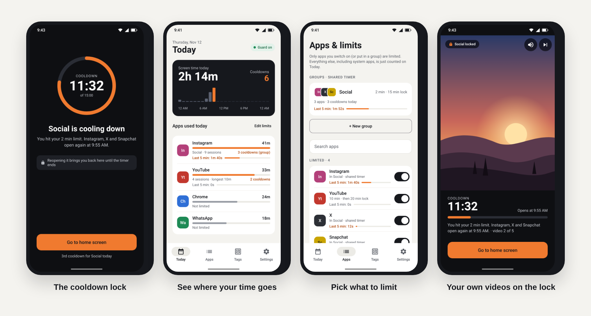
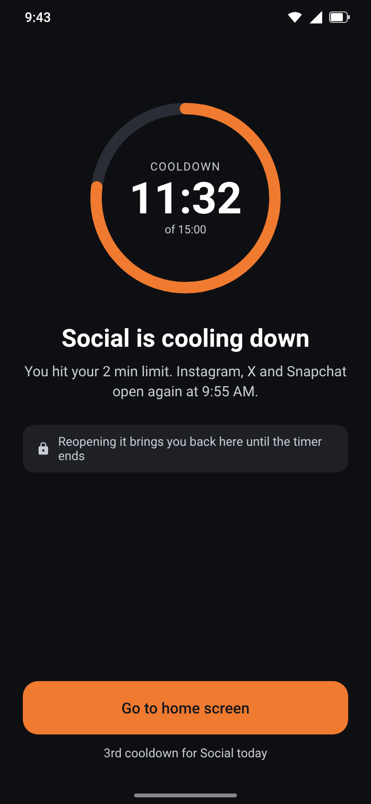
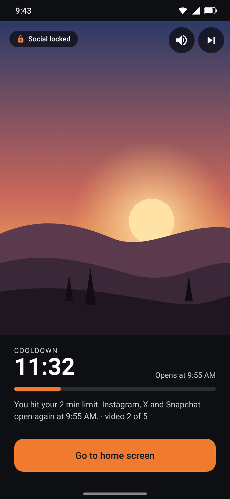
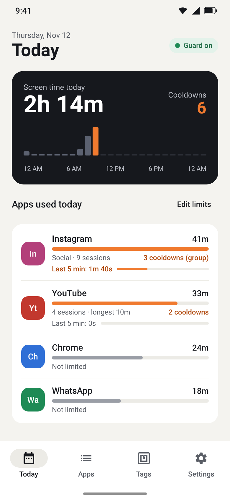
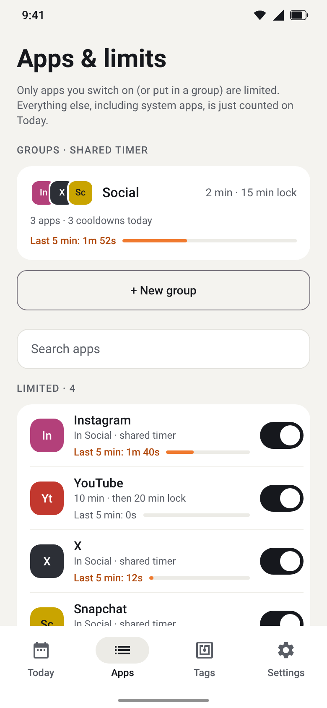
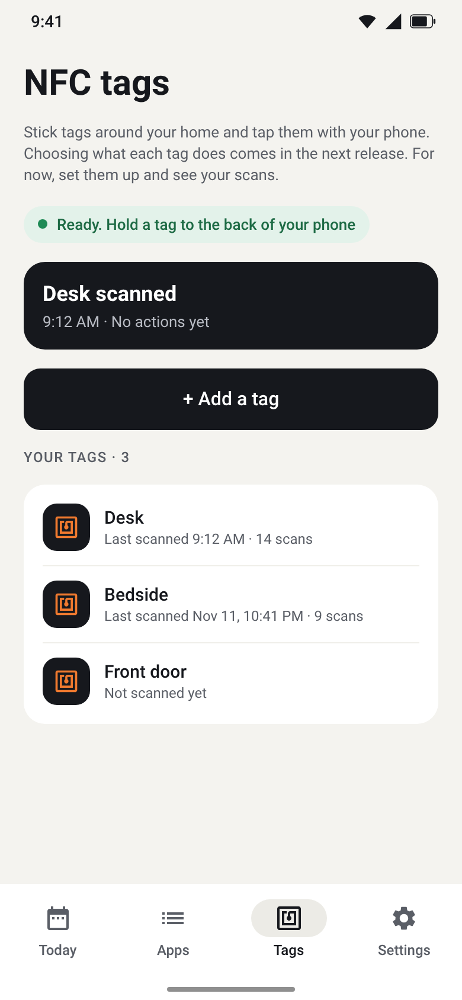

# Usage Guard

**Stop doom-scrolling with a hard cooldown.** Pick the apps you lose time in. When you've been in one for 2 minutes, it locks behind a countdown screen, and it won't open again until the cooldown is over.

[](https://github.com/nishithdev/usage-guard-android/releases/latest)

Android 8.0 or newer · Free · No account · No internet permission: nothing ever leaves your phone



<table>
  <tr>
    <td align="center"><br><sub><b>Cooldown lock</b><br>The app stays locked until the timer ends</sub></td>
    <td align="center"><br><sub><b>Motivational video</b><br>Optional, from your own gallery</sub></td>
    <td align="center"><br><sub><b>Today</b><br>Screen time, cooldowns, last 5 min</sub></td>
    <td align="center"><br><sub><b>Apps &amp; limits</b><br>Groups and per-app rules</sub></td>
    <td align="center"><br><sub><b>NFC tags</b><br>Set up and scan stickers</sub></td>
  </tr>
</table>

<sub>Screens shown with sample data. In the app you'll see your own apps' icons and usage.</sub>

---

## Install on your phone

Usage Guard isn't on the Play Store yet, so you install it straight from GitHub. It takes about two minutes.

1. **Download.** On your phone, open the [latest release](https://github.com/nishithdev/usage-guard-android/releases/latest) and tap the file ending in **`.apk`** under *Assets*.
2. **Allow the install.** Open the downloaded file. If Android asks, allow your browser to *install unknown apps*, then tap **Install**.
   - If **Play Protect** warns that the app is from an unknown developer, tap **More details → Install anyway**. It does this for any app that isn't from the Play Store.
3. **Open Usage Guard** and follow the setup screen. It asks for two permissions:
   - **Usage access**, to see which app is open and for how long
   - **Display over other apps**, to show the cooldown lock
4. **If a switch is greyed out or says "App was denied access":** Android blocks these permissions for apps installed outside the Play Store until you unlock them once:
   1. Long-press the Usage Guard icon → **App info**
   2. Tap **⋮** (top-right) → **Allow restricted settings**, then confirm
   3. Go back to Usage Guard and grant the permission again

   *(The setup screen has an **Open App info** button that takes you straight there.)*
5. **Optional but recommended:** allow notifications and turn off battery optimization when the setup screen offers it. Some phones (Samsung, Xiaomi, OnePlus) otherwise stop the guard in the background.
6. Go to the **Apps** tab and switch on the apps you want to limit. A **Social** group is already set up with any social apps you have installed.

**Updating:** download the new `.apk` from Releases and install it over the old one. Your settings are kept.

**Uninstalling:** like any app. Long-press the icon → Uninstall.

---

## What it does

| | |
|---|---|
| **Cooldown lock** | Use a limited app continuously past its limit (default **2 min**) and a full-screen lock takes over for the cooldown (default **15 min**). What was playing is paused. Reopening the app brings the lock back until the timer ends. |
| **You choose what's limited** | Only apps you switch on, or put in a group, are ever locked. System apps, your phone dialer and everything else are just counted. |
| **Per-app rules** | Give each app its own limit and cooldown. For example, YouTube gets 10 min, then a 20 min lock. |
| **Groups** | Apps in a group share one timer and lock together, so you can't escape Instagram by jumping to X. |
| **Motivational videos** | Optionally play videos you pick from your gallery on the lock screen, shuffled or in order. |
| **Today screen** | Screen time, an hourly chart, time per app, sessions, cooldowns, and how long you've used each limited app in the **last 5 minutes**. |
| **NFC tags** | Write and name NFC stickers, then tap them with your phone (even with the app closed). Scan history is kept. *Home actions per tag are coming.* |

### Privacy

Usage Guard has **no internet permission**. Usage data, limits and videos stay on your device. Gallery videos are chosen with Android's photo picker, so the app only sees the videos you pick.

---

## Found a bug or have an idea?

[Open an issue](https://github.com/nishithdev/usage-guard-android/issues/new/choose). Please include your phone model, Android version and the app version (shown at the bottom of the app's Settings tab).

## Known limitations

- The 2 minutes must be **continuous**. Leaving an app for more than 30 seconds starts a new session (change this in Settings → *New session after*).
- NFC tags only scan while the phone is **unlocked with the screen on**. That's an Android rule.
- A few music apps ignore Android's request to pause, so their audio may keep playing behind the lock.

---

## For developers

Requires JDK 17+ and the Android SDK (platform 35).

```bash
echo "sdk.dir=/path/to/Android/sdk" > local.properties
./gradlew assembleRelease
# → app/build/outputs/apk/release/app-release.apk
```

Local release builds are signed with your debug key so they install directly.

### Publishing a release

Every push to `main` is built by the **Build** workflow. To publish a release that testers can download:

1. Bump `versionCode` and `versionName` in `app/build.gradle.kts`.
2. Optionally add `release-notes/vX.Y.md`.
3. Publish, either way:
   - On GitHub: **Actions → Release → Run workflow**, then type the version (e.g. `v0.6`)
   - Or from a terminal: `git tag v0.6 && git push origin v0.6`

   The **Release** workflow builds the APK, creates the tag and GitHub Release, and attaches the APK.

To sign every release with the same key, so testers can update without uninstalling, add these repository secrets under *Settings → Secrets and variables → Actions*: `SIGNING_KEYSTORE_BASE64`, `SIGNING_STORE_PASSWORD`, `SIGNING_KEY_ALIAS`, `SIGNING_KEY_PASSWORD`. Without them, releases use a throwaway key.

### Project layout

```
app/src/main/java/com/nishith/usageguard/
  GuardService.kt     foreground service: tracks the app in front, enforces limits
  LockShield.kt       instant overlay shown when a limit is hit
  LockActivity.kt     full-screen cooldown lock (plus optional video)
  GuardPrefs.kt       settings, limits, groups, lock state
  UsageRepo.kt        usage stats, today's totals, last-5-minutes usage
  NfcTags.kt          tag storage and NFC read/write
  TagScanActivity.kt  opens when a tag is tapped with the app closed
  ui/                 Compose screens: Setup, Today, Apps, Group editor, Tags, Settings
```

## Version history

| Version | Highlights |
|---|---|
| **0.5** | Locks no longer missed (screen switches inside apps, Android 15 launch rules), warning when Android stops the guard, last-5-minutes usage |
| **0.4** | Motivational videos on the lock screen, NFC tags |
| **0.3** | Opt-in limits: only the apps you add are locked |
| **0.2** | Real app blocking with a full lock screen, groups |
| **0.1** | Tracking, cooldown lock, Today, Settings, setup |
